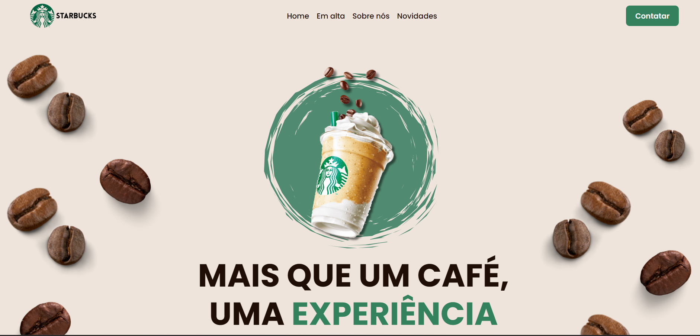
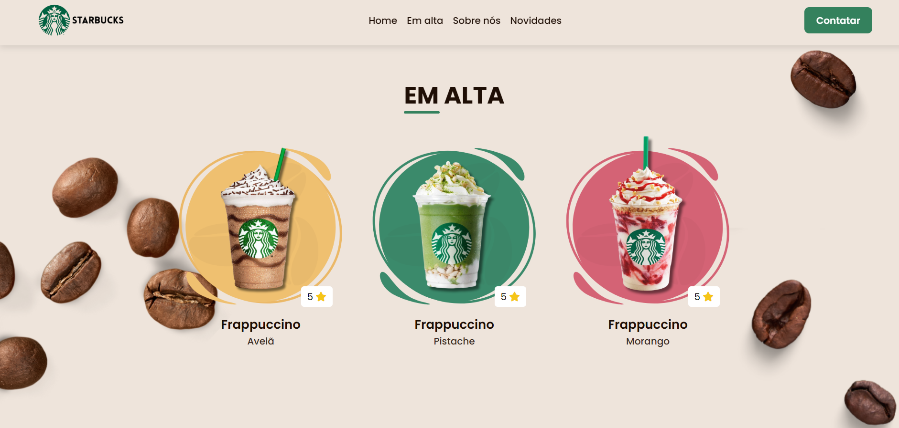
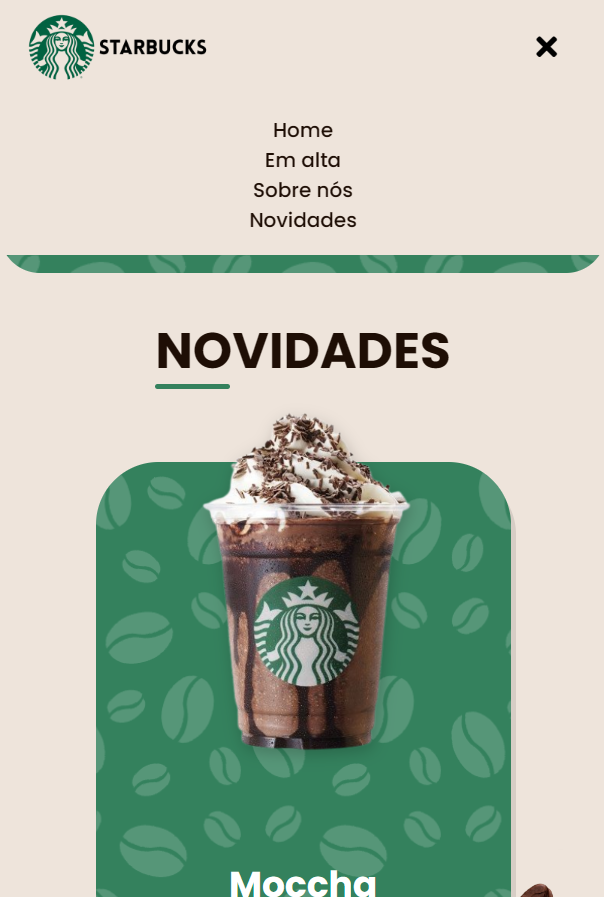

# Landing page Starbucks

Este repositório contém o **projeto 2 de uma jornada de 41 projetos para o GitHub**. A proposta é praticar desenvolvimento front-end criando páginas e interfaces com HTML, CSS e JavaScript.

O projeto é uma landing page inspirada na Starbucks, com apresentação de bebidas, uma seção sobre a marca e uma área de novidades. Ele faz parte de uma videoaula disponível no YouTube com **Larissa Kich** e foi desenvolvido como exercício de acompanhamento e aprendizagem.

## O que foi praticado

- Estruturação de conteúdo com HTML semântico;
- Estilização e organização de componentes com CSS;
- Layout responsivo com media queries;
- Interação JavaScript no menu de navegação para dispositivos móveis;
- Uso de imagens, ícones e fontes externas.

## Tecnologias

- HTML5
- CSS3
- JavaScript

## Como visualizar

Abra o arquivo `index.html` no navegador. Para uma experiência de desenvolvimento local, também pode abrir esta pasta num editor como o VS Code e iniciar um servidor local, por exemplo, com a extensão Live Server.

## Imagens do projeto

Capturas de tela da landing page em diferentes seções e tamanhos de tela:

### Página inicial



### Seção de bebidas em alta



### Menu mobile e seção de novidades



## Estrutura

```text
Landing-page-starbucks/
├── README.md
├── index.html
└── src/
    ├── css/
    │   ├── navbar.css
    │   ├── style-media-query.css
    │   ├── style.css
    │   └── variables.css
    ├── images/
    │   └── img-description/
    │       ├── img1.png
    │       ├── img2.png
    │       └── img3.png
    └── js/
        └── script.js
```

Este projeto tem finalidade educativa e faz parte da jornada de prática de desenvolvimento web.
